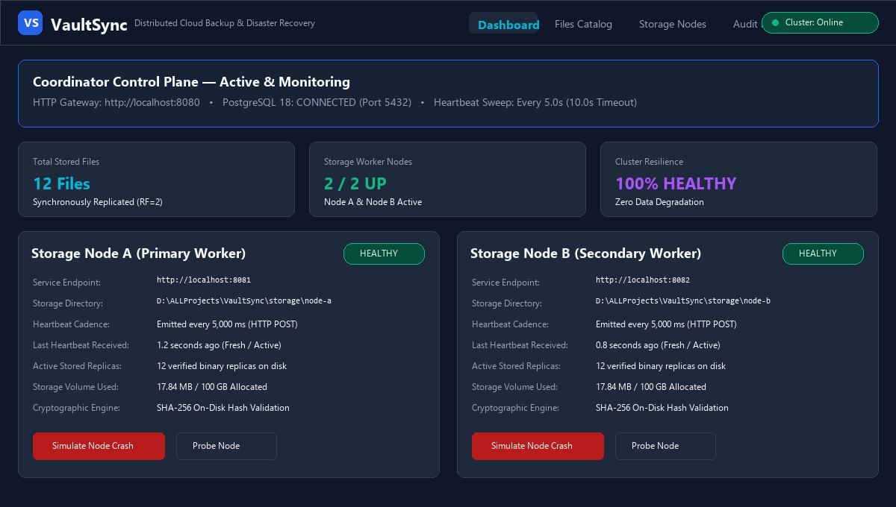
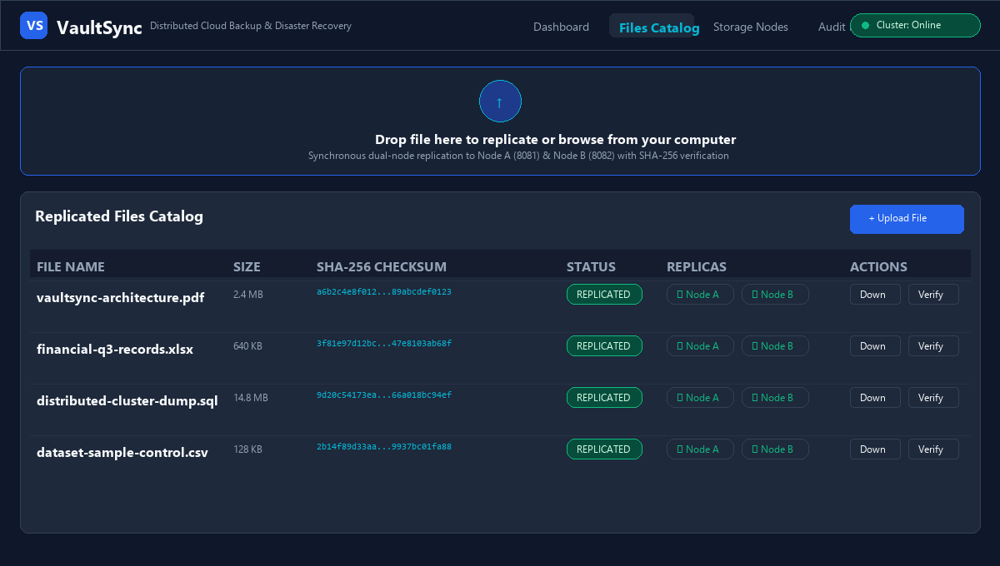
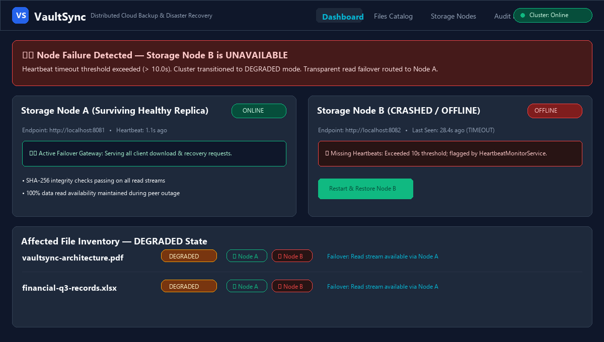
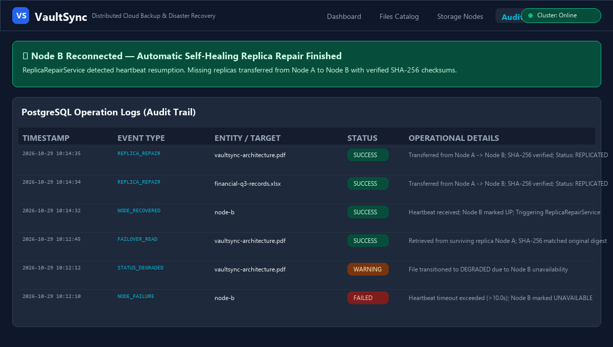

# VaultSync — Distributed Cloud Backup & Disaster Recovery System

[](https://openjdk.org/)
[](https://spring.io/projects/spring-boot)
[](https://www.postgresql.org/)
[](https://react.dev/)
[](https://vitejs.dev/)

VaultSync is an explainable distributed cloud backup and disaster recovery prototype built for the **Distributed Computing Systems (DCS)** curriculum. It demonstrates how a central coordinator coordinates file replication across multiple independent storage worker services, monitors cluster health using periodic heartbeats, detects node outages, recovers data through surviving replicas, automatically repairs missing copies, and verifies cryptographic integrity with SHA-256 checksums.

---

## 1. System Architecture

The VaultSync cluster operates as five decoupled, cooperating components on localhost:

```
                            +---------------------------------------+
                            |       React + Vite Frontend UI        |
                            |       (http://localhost:5173)         |
                            +-------------------+-------------------+
                                                |
                                                | HTTP / REST (Vite Proxy: /api)
                                                v
                            +---------------------------------------+
                            |       Spring Boot Coordinator         |
                            |       (http://localhost:8080)         |
                            +---------+-------------------+---------+
                                      |                   |
            +-------------------------+                   +-------------------------+
            | JDBC (JPA / Hibernate)                      | HTTP REST Clients       |
            v                                             | (StorageNodeClient)     |
+-----------------------+                                 v                         v
|     PostgreSQL 18     |                     +-----------------------+ +-----------------------+
|   (Port 5432: vaultsync) |                  |     Storage Node A    | |     Storage Node B    |
| - files               |                     | (http://localhost:8081) | (http://localhost:8082) |
| - storage_nodes       |                     | Directory:            | | Directory:            |
| - file_replicas       |                     |  ./storage/node-a/    | |  ./storage/node-b/    |
| - operation_logs      |                     +-----------------------+ +-----------------------+
+-----------------------+
```

---

## 2. Core DCS Concepts Demonstrated

1. **Distribution & Decoupling:**
   The coordinator and storage workers run as separate operating-system processes on independent ports (`8080`, `8081`, `8082`), storing physical binary files in isolated disk directories.
2. **Synchronous Two-Node Replication:**
   Every uploaded file is hashed using SHA-256 and replicated simultaneously to both Node A and Node B. A file is marked `REPLICATED` only after both storage nodes confirm successful writes and matching checksums.
3. **Heartbeat Failure Detection:**
   Storage workers emit periodic heartbeats every 5 seconds (`POST /api/nodes/{id}/heartbeat`). The coordinator's background monitor (`HeartbeatMonitorService`) checks node freshness against a 10-second timeout threshold, automatically transitioning unresponsive nodes to `UNAVAILABLE`.
4. **Graceful Degradation & Fault Tolerance:**
   When a node goes offline, affected files automatically degrade from `REPLICATED` to `DEGRADED`. The system remains fully operational: clients continue to download and recover files through the surviving healthy replica.
5. **Failover Recovery & Cryptographic Verification:**
   Recovery requests (`POST /api/files/{id}/recover`) stream bytes from the healthy surviving node, recalculate the SHA-256 hash, and confirm byte-level equality with the original upload digest before reporting success.
6. **Automated Replica Repair (Self-Healing):**
   When an offline node restarts, the coordinator detects its heartbeat reconnection (`NODE_RECOVERED`), initiates `ReplicaRepairService`, re-replicates the missing copy from the surviving replica with SHA-256 verification, and restores the file status back to `REPLICATED`.
7. **Concurrency Safety:**
   File-level locking (`ConcurrentHashMap<String, Boolean>`) prevents duplicate or conflicting repair jobs from corrupting files or creating orphan database records.
8. **Persistent Audit Trail:**
   All lifecycle events (`FILE_UPLOAD`, `NODE_FAILURE_DETECTED`, `RECOVERY_VERIFY`, `NODE_RECOVERED`, `REPLICA_REPAIR`, `SIMULATED_FAILURE`, `SIMULATED_RECOVERY`) are logged in the PostgreSQL `operation_logs` table.

---

## 3. Port & Service Mapping

| Service | Port | Directory / Storage Location | Role |
| :--- | :--- | :--- | :--- |
| **Frontend Dashboard** | `5173` | `frontend/` | React single-page UI with cursor glow effect |
| **Coordinator API** | `8080` | `backend/` | Central catalog, replication & health orchestrator |
| **Storage Node A** | `8081` | `backend/storage/node-a/` | Independent chunk storage worker A |
| **Storage Node B** | `8082` | `backend/storage/node-b/` | Independent chunk storage worker B |
| **PostgreSQL Database** | `5432` | Database: `vaultsync` | Metadata catalog, replica mapping & audit history |

---

## 4. Database Schema (PostgreSQL 18)

- **`files`**: `id` (VARCHAR 64 PK), `original_filename`, `size_bytes`, `mime_type`, `sha256_checksum`, `status` (`REPLICATED`/`DEGRADED`/`FAILED`), `last_recovery_result`, `created_at`.
- **`storage_nodes`**: `id` (VARCHAR 50 PK), `name`, `endpoint`, `storage_directory`, `status` (`HEALTHY`/`UNAVAILABLE`), `is_simulated_down`, `last_heartbeat`, `created_at`.
- **`file_replicas`**: `id` (VARCHAR 64 PK), `file_id` (FK `files`), `node_id` (FK `storage_nodes`), `storage_key`, `status` (`AVAILABLE`/`UNAVAILABLE`), `created_at`. Unique constraint on `(file_id, node_id)`.
- **`operation_logs`**: `id` (VARCHAR 64 PK), `operation_type`, `file_id`, `node_id`, `status` (`SUCCESS`/`WARNING`/`FAILED`), `message`, `created_at`.

---

## 5. Prerequisites

- **Java JDK:** Version 21 or higher (OpenJDK 21 / 25).
- **Maven:** Version 3.9+ (or use pre-built executable JAR).
- **Node.js & npm:** Node.js 18+ and npm 9+.
- **PostgreSQL:** PostgreSQL 18 running on port `5432`.
  - Database name: `vaultsync`
  - Default user: `postgres`

---

## 6. Localhost Startup Workflow

### Option A: One-Click Startup (Recommended)

From the project root directory, run PowerShell:
```powershell
.\start-all.ps1
```
This script verifies PostgreSQL connectivity, launches Storage Node A (`8081`), Storage Node B (`8082`), the Coordinator (`8080`), and the Vite Frontend (`5173`) in background processes.

To cleanly stop all VaultSync processes:
```powershell
.\stop-all.ps1
```

---

### Option B: Manual Command-Line Startup

If you prefer running each service in a dedicated terminal window:

1. **Build Backend (first time or after code changes):**
   ```powershell
   cd backend
   mvn package -DskipTests
   ```

2. **Terminal 1 — Storage Node A (Port 8081):**
   ```powershell
   cd backend
   java -Xms32m -Xmx128m -jar target/vaultsync-backend-1.0.0-SNAPSHOT.jar --server.port=8081 --node.id=node-a --node.name="Node A" --node.dir="./storage/node-a"
   ```

3. **Terminal 2 — Storage Node B (Port 8082):**
   ```powershell
   cd backend
   java -Xms32m -Xmx128m -jar target/vaultsync-backend-1.0.0-SNAPSHOT.jar --server.port=8082 --node.id=node-b --node.name="Node B" --node.dir="./storage/node-b"
   ```

4. **Terminal 3 — Coordinator (Port 8080):**
   ```powershell
   cd backend
   $env:DB_PASSWORD = "your_postgres_password"
   java -Xms64m -Xmx256m -jar target/vaultsync-backend-1.0.0-SNAPSHOT.jar
   ```

5. **Terminal 4 — React Frontend (Port 5173):**
   ```powershell
   cd frontend
   npm run dev -- --host 127.0.0.1 --port 5173
   ```

6. Open your browser at: **`http://localhost:5173`**

---

## 7. System Walkthrough & UI Screenshots

The VaultSync web dashboard (`http://localhost:5173`) provides an interactive control plane for monitoring cluster topology, file replication, fault injection, transparent failover, and automated self-healing.

### 7.1 Real-Time Cluster Health & Node Heartbeat Monitoring


- **Coordinator Overview:** Displays active HTTP coordinator status on port `8080`, live PostgreSQL 18 connection state on port `5432`, and the background heartbeat monitor configuration.
- **Node Health Cards:** Dedicated panels for **Storage Node A** (`8081`) and **Storage Node B** (`8082`) showing live status badges (`HEALTHY`), physical storage directory paths, resident replica counts, and last heartbeat timestamps updating in real time every 5 seconds.
- **Interactive Controls:** Includes one-click fault-injection buttons (*"Simulate Node Crash"*) and manual probing actions for live demonstration.

---

### 7.2 File Upload & Synchronous Multi-Node Replication


- **Drag-and-Drop Ingestion:** Files uploaded via the web interface or REST API are synchronously streamed to both Storage Node A and Storage Node B before confirmation.
- **Cryptographic Verification (SHA-256):** The coordinator computes a 256-bit SHA-256 digest directly from the incoming byte stream and stores it as the canonical checksum in PostgreSQL.
- **Replication Status:** Files achieve `REPLICATED` status only after both worker nodes acknowledge successful disk writes. Green node badges (`✓ Node A`, `✓ Node B`) confirm physical copy existence.

---

### 7.3 Fault Injection, Heartbeat Timeout & DEGRADED Status


- **Heartbeat Timeout Detection:** When Storage Node B is terminated or simulated as failed, the coordinator's background monitor detects missed heartbeats and marks Node B as `UNAVAILABLE` after the 10-second threshold.
- **Graceful Degradation:** The cluster immediately transitions affected files to `DEGRADED` status with an amber warning badge, reflecting that only one active replica remains.
- **Transparent Read Failover:** Client download and verification requests automatically bypass the crashed node and stream bytes from the healthy surviving replica (**Node A**), maintaining 100% read availability with zero client-side exceptions.

---

### 7.4 Self-Healing Replica Repair & Operational Audit Log


- **Autonomous Self-Healing:** Once Node B recovers and re-establishes heartbeat communication, the coordinator automatically triggers `ReplicaRepairService`.
- **Donor Re-Replication:** The missing replica is fetched from surviving donor Node A, written to Node B, and verified against the canonical SHA-256 checksum before promoting the file status back to `REPLICATED`.
- **PostgreSQL Audit Trail:** The live audit log table streams recent events directly from PostgreSQL's `operation_logs` table, recording timestamps, operation types (`NODE_FAILURE`, `FAILOVER_READ`, `NODE_RECOVERED`, `REPLICA_REPAIR`), and integrity outcomes.

---

## 8. REST API Reference

### Coordinator Endpoints (Port 8080)
- `GET /api/health` — Coordinator health and PostgreSQL database status.
- `GET /api/nodes` — List registered storage nodes, live health, heartbeats, and stored replica counts.
- `POST /api/nodes/check` — Force an immediate heartbeat and reachability probe on all nodes.
- `POST /api/nodes/{id}/simulate-failure` — Demo control: simulate node failure.
- `POST /api/nodes/{id}/simulate-recovery` — Restore node and trigger replica repair.
- `POST /api/nodes/repair` — Trigger manual replica repair sweep across all degraded files.
- `POST /api/files` — Upload file multipart form data, compute SHA-256, and replicate to both nodes.
- `GET /api/files` — List stored files, SHA-256 checksums, and replica statuses.
- `GET /api/files/{id}` — Get metadata and replica details for a single file.
- `GET /api/files/{id}/download` — Stream file content with failover and SHA-256 integrity check.
- `POST /api/files/{id}/recover` — Test recovery from healthy replica and verify checksum.
- `DELETE /api/files/{id}` — Delete file metadata and remove replicas from storage nodes.
- `GET /api/operations` — Retrieve the last 20 audit log events from PostgreSQL.

### Storage Node Endpoints (Ports 8081 & 8082)
- `GET /api/health` — Storage node health, storage directory, total stored files, and byte counts.
- `POST /api/storage/files/raw` — Store raw file payload stream.
- `GET /api/storage/files/{storageKey}` — Retrieve stored file bytes.
- `GET /api/storage/files/{storageKey}/verify` — Verify live on-disk SHA-256 checksum.
- `DELETE /api/storage/files/{storageKey}` — Delete stored file.
